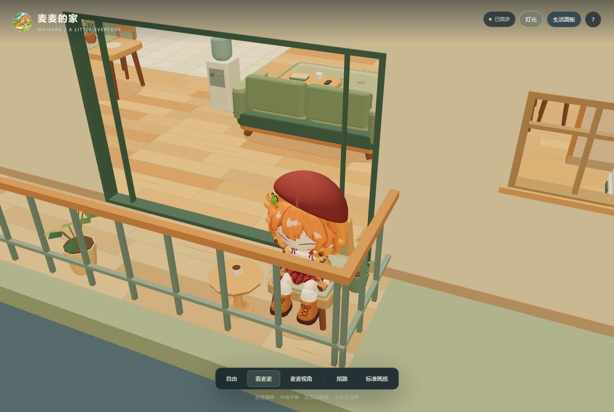

# 麦麦的小屋


在 MaiBot 的网页房间里陪麦麦待一会儿：指引她走动、坐下休息、切换表情，照料菜园、看视频，或打开专属聊天。网页操作、QQ 指令和其他插件接入共用同一份房间状态。

兼容范围：MaiBot **1.3.7–1.4.99**、MaiBot SDK **2.12.0–2.99.99**，使用自定义 WebUI v2。插件 ID 为 `cateye.maimai_room`。

## 能做什么

- **房间互动**：走动、坐下、睡觉、起床、表情和摸头等互动；提供自由、跟随和麦麦第一人称视角。
- **菜园**：八块田、十二种作物，支持播种、浇水、施肥、采收、买种子和自主照料。
- **专属聊天**：在房间里与 MaiBot 对话，使用独立的宿主聊天流，对话可在宿主聊天记录中查看。
- **电视**：播放选择的照片或视频，也可接收其他插件指定的媒体直链；支持画面保存和主动触发的视觉点评。
- **插件联动**：其他插件可以推送日程、情绪和动作，控制媒体播放，订阅用户互动信号。未接入日程时，麦麦按固定作息活动。




## 安装

1. 从 [Releases](https://github.com/cateyemizuki/maimai-room/releases) 下载 `MaiSaka-Room-vX.Y.Z.zip`，在 MaiBot 插件管理中选择 ZIP 安装；也可解压到 `plugins/maimai_room`，确保该目录直接包含 `_manifest.json` 和 `plugin.py`。
2. 重启 MaiBot，在插件管理中启用「麦麦的小屋」。依赖 `Pillow >= 10.0.0` 已在插件清单中声明。
3. 从宿主侧栏打开「麦麦的小屋」。页面路径为 `/extensions/cateye.maimai_room/room`，升级后刷新已经打开的房间页。

前端和角色资源随插件提供，运行时无需另外启动网页服务。

## 房间操作

| 操作 | 效果 |
| --- | --- |
| 左键拖动 | 旋转视角 |
| 中键拖动 | 平移视角，进入自由模式 |
| 双击左键 | 指引麦麦走到可达的地面位置 |
| 双击中键 | 选中沙发等家具，再选择走过去或使用 |
| 单击田块 | 打开菜园并选中该块田 |
| 单击麦麦 | 摸摸头 |
| 滚轮、双指 | 缩放；第一人称中调节视野 |
| Esc | 收起面板 |

「生活面板」中可以切换动作、表情和模型精度，也可打开电视与聊天；底部工具栏切换视角和画质。麦麦视角随角色眼点移动，左键拖动可以转头。只有麦麦视角隐藏头部并保留身体和双手，切回自由或跟随后恢复头部显示。

「一起待一会儿」提供摸头、戳脸、喂点心、倒水、陪玩、跳舞、伸懒腰和行礼。站立和坐姿分别呈现动作；行走、睡眠、园艺工作或上一动作未结束时，先等麦麦完成当前活动。立绘模式仅呈现简单姿态。

表情可选自然、开心、困、生气、低落、放松、惊讶、眨单眼、惊喜和委屈；「恢复」回到自然表情。

挡住麦麦的墙会整墙渐变透明；外部视角隐藏顶棚，第一人称显示室内顶棚。房屋、菜园和小径共用连续地基，房屋与菜园的连接处保留草坪。

## 权限和常用设置

在宿主插件配置页调整设置。网页操作、QQ 指令和 bot 工具分别控制权限：

- **网页**：默认允许已登录 MaiBot WebUI 的用户操作，可用 `access.webui_controls` 关闭。
- **QQ 指令**：使用 `access.allowed_users` 操作者名单；名单为空时，默认继承宿主中明确配置的 QQ 管理员。`access.allowed_groups` 可进一步限制群聊。非操作者默认不能查询状态。
- **bot 状态调节工具**：默认开启，私聊和群聊均为空白名单，填入允许的会话后才能使用。其他插件接管行为时，工具自动停用；`tools.force_enabled` 可在接管期间继续开放工具，名单限制仍生效。

例如，只让指定 QQ 私聊和群聊使用状态调节工具：

```toml
[tools]
private_mode = "whitelist"
private_users = ["qq:<你的QQ号>"]
group_mode = "whitelist"
groups = ["<允许的群号>"]
```

两类名单也可分别切换为 `blacklist`。空白名单不放行会话，空黑名单放行全部对应会话。房间专属聊天流的工具身份为 `maimai_room:room_owner`，需要时将它加入私聊名单。

| 设置 | 默认值 | 用途 |
| --- | --- | --- |
| `behaviour.automatic` | `true` | 跟随已接入的日程；未接入时使用固定作息 |
| `behaviour.manual_hold_seconds` | `900` | 手动动作保持时长，单位秒 |
| `performance.render_grace_seconds` | `600` | 页面隐藏后保留场景资源的时长，单位秒 |
| `performance.desktop_fps` | `60` | 标准画质目标帧率；省电档为 24 |
| `chat.enabled` | `true` | 启用房间专属聊天 |
| `tv.review_enabled` | `true` | 允许将主动选择的电视画面交给宿主视觉模型点评，可能产生调用费用 |

完整默认配置见 [config.example.toml](config.example.toml)。固定作息采用上海时区，07:00 起床、22:00 就寝。

页面首次进入时才加载场景；隐藏后暂停渲染和轮询，默认保留资源 10 分钟。保活只对仍存在的页面实例生效，宿主切换侧栏销毁页面时会立即释放资源。

## QQ 指令

`/房间` 与 `/room` 通用，发送者须满足上面的 QQ 操作者权限。

| 示例 | 功能 |
| --- | --- |
| `/room 状态` | 查看位置、动作和来源 |
| `/room 走 阳台` | 走到阳台 |
| `/room 坐 沙发` | 走到沙发并坐下 |
| `/room 睡`、`/room 唤醒` | 就寝、起床 |
| `/room 心情 开心` | 切换临时表情 |
| `/room 自动` | 解除手动动作保持，恢复自动活动 |
| `/room 菜园 状态` | 查看菜园 |
| `/room 菜园 播种 5 胡萝卜` | 在第 5 块田播种 |
| `/room 菜园 浇水 5` | 安排照料第 5 块田 |

田块编号为 1–8。园艺动作排队成功后，麦麦会走到田边工作，完成后才结算物资。

## 聊天、电视与数据

房间聊天使用 MaiBot 已有的模型配置，发送消息后由宿主处理。聊天镜像与房间、菜园存档位于本插件的数据目录，迁移时一并备份。

选择照片或视频后，媒体先在当前页面播放；保存单帧和视觉点评分别由按钮触发，不会自动截取或发送。在线媒体需提供可直接播放的 HTTP(S) 音视频地址，普通播放器网页、HLS/DASH 清单和 DRM 播放器不在支持范围内。

如果无法操作，先检查插件是否启用及相应权限；QQ 指令权限和 bot 工具会话名单需要分别设置。麦麦停留在手动动作时，可点「跟随日程」或发送 `/room 自动`。图形渲染中断时，可点击页面上的重试入口重新进入。

## 其他插件接入

日程、情绪、行为接管、媒体控制和互动订阅的示例见 [接入指南](INTEGRATION.md)，全部接口、参数和回执见 [API 文档](API.md)。这些接口通过 MaiBot SDK 调用，无需另开服务端口。

## 来源与许可

插件代码采用 [MIT](LICENSE)。房间布局、导航和菜园规则参考 [sh2234113 / feiyu-room-template](https://github.com/sh2234113/feiyu-room-template)，保留原作者与贡献者的 [MIT 许可](web/licenses/LICENSE) 和 [灵感来源](web/licenses/INSPIRATION.md)。Three.js 等依赖说明见 [第三方许可](web/THIRD_PARTY_NOTICES.md)。

麦麦形象参考 [MaiBot 官方角色设定](https://maibot.chat/about/)。角色模型、立绘和 Logo 等图像素材不因插件代码采用 MIT 而重新授权。
