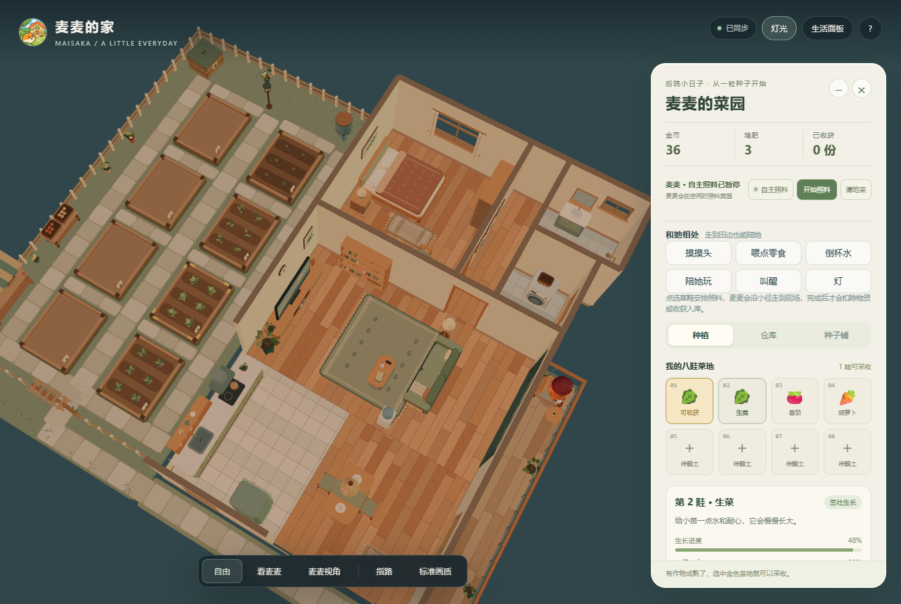

# 麦麦的小屋


MaiBot SDK 自定义 3D 房间插件。角色、家具互动、日程、园艺和 QQ 指令共用服务端状态，房间聊天使用独立的原生宿主聊天流。

适配 MaiBot 1.3.19 及以上、SDK 2.20.0 及以上、自定义 WebUI 协议 v2。插件 ID 为 `cateye.maimai_room`。

## 界面预览

本地功能验收示例。




## 安装

安装包见 [GitHub Releases](https://github.com/cateyemizuki/maimai-room/releases)，接入文档见 [API.md](API.md)。

1. 将安装包解压到 MaiBot 的 `plugins/maimai_room`，确认该目录直接包含 `_manifest.json`。
2. 使用宿主插件管理启用「麦麦的小屋」。
3. 从宿主侧栏进入自定义页面，路径为 `/extensions/cateye.maimai_room/room`。
4. 升级后刷新已经打开的页面，使它读取新的控件与保活设置。

运行时由 MaiBot 提供 SDK，清单声明 Pillow 依赖。WebUI 自带 Three.js 和运行资源，前端构建使用锁定版本的 esbuild。安装包需要保留 `web/index.html`、`web/runtime/`、`web/assets/` 和 `room-logo.webp`。

## 操作

| 输入 | 效果 |
| --- | --- |
| 左键拖动 | 围绕当前关注点旋转 |
| 中键拖动 | 在水平面平移，进入自由视角 |
| 双击左键 | 指引麦麦走到可达的地面位置 |
| 双击中键 | 尝试选中沙发等交互物，再选择走过去或使用 |
| 单击实际田块 | 打开菜园并选中该田块 |
| 滚轮、双指 | 缩放，第一人称中调节视野 |
| Esc | 收起面板 |

镜头提供「自由」「看麦麦」「麦麦视角」。麦麦视角跟随实际头部位置和朝向，支持左拖转头。家具和田块通过场景选取。

房屋使用连续底板及木地板、地砖装饰，遮挡墙采用低位剖切，保留房间边界。角色默认使用标准模型，可以按需切换精细模型。开心表情通过现有形态键组合呈现闭眼与弧形微笑。

## 权限与工具

`access.allowed_users` 非空时使用本插件的 QQ 操作者名单。名单为空且 `inherit_host_operators=true` 时，经 SDK 读取宿主 `plugin.permission` 中明确配置的 QQ 管理员。`allowed_groups` 可进一步限定群，`public_status` 默认关闭。

bot 状态工具默认开启，群聊和私聊均使用空白名单。填入会话身份后才可调用。

```toml
[tools]
enabled = true
force_enabled = false
private_mode = "whitelist"
private_users = []
group_mode = "whitelist"
groups = []
```

QQ 私聊可填纯号码或 `qq:号码`，房间专属聊天流的身份为 `maimai_room:room_owner`。两类名单可以分别使用 `blacklist` 模式。

第三方接管期间自动关闭状态工具，`force_enabled=true` 可继续开放工具，会话名单仍然生效。WebUI 控制由 `access.webui_controls` 配置。

## QQ 指令

中文根 `/房间` 与英文根 `/room` 通用。

| 指令 | 功能 |
| --- | --- |
| `/room 状态` | 当前动作、位置和来源 |
| `/room 走 阳台` | 按房间通道走过去 |
| `/room 坐 沙发` | 走到沙发并坐下 |
| `/room 睡`、`/room 唤醒` | 就寝、起床 |
| `/room 心情 开心` | 调整临时表情 |
| `/room 自动` | 解除手动姿态覆盖 |
| `/room 菜园 状态` | 查看园艺情况 |

园艺还支持翻土、播种、浇水、施肥、采收、买种子和自主照料。畦号为 1–8，接口内部索引为 0–7。排队成功表示安排已接受，麦麦到现场并工作后才结算物资。

## 第三方接入

详细的鉴权、全部公开 API、参数、回执、错误处理、幂等及示例见 [独立 API 文档](API.md)，快速接线说明见 [INTEGRATION.md](INTEGRATION.md)。

- 日程提供方通过 `room_control` 接管，并主动推送当前活动或动作。
- 没有第三方日程时使用上海时区固定作息，07:00 起床、22:00 就寝。
- 互动信号支持即时回调与按游标补读，覆盖点击、镜头手势、房间与园艺动作及聊天提交。
- 视频提供方可指定 HTTP(S) 音视频直链，并控制暂停、继续、跳转和音量。
- 房间专属聊天平台为 `maimai_room`，独立流和页面镜像支持后续续看。

## 资源与配置

```toml
[performance]
render_grace_seconds = 600
desktop_fps = 60
```

标准画质默认 60 FPS，省电档为 24。页面隐藏后默认保留场景资源 10 分钟，期限内返回可复用，到期释放 WebGL 上下文。首次进入前按需加载。宿主侧栏切换会卸载 iframe，跨路由保留需要宿主页面支持。

标准模型采用无损 gzip 传输，按宿主预算分成 9 块。两档原始 GLB 及对应压缩文件随包保存。浏览器私有资源通道、单帧保存和用户主动触发的视觉点评见 API 文档。

配置模板为 `config.example.toml`。插件存档包含房间、园艺、互动游标及回调管理回执，聊天镜像为专属数据目录下的 `room_chat.json`。备份或迁移时使用宿主插件数据目录。

## 开发验证

前端构建在 `web/` 中执行 `npm ci` 和 `npm run build`。宿主 SDK 环境下运行下列回归。

```text
python -m unittest discover -s tests -p "test_*.py"
python tests/validate_host.py --host-src <MaiBot源码目录> --report <报告路径>
```

测试覆盖权限、日程接管、寻路、快照投影、事件、专属聊天回执和媒体。接口约束由原始宿主校验器检查，实际宿主与浏览器验收按发行记录执行。

## 来源与许可

源码采用 MIT，第三方许可保存在 `web/licenses/` 和 `web/THIRD_PARTY_NOTICES.md`。房间规则与导航源自 [feiyu-room-template](https://github.com/sh2234113/feiyu-room-template)，固定参考提交为 `201a4ecad48e7e77cfdd6422fb8f55a77a7b9f5f`，场景几何已本地重建。

角色形象参考 [MaiBot 官方角色设定](https://maibot.chat/about/)，运行模型为本地制作，Logo 使用本次提供的房屋与橙子图。原有署名和第三方许可随源码保留。
